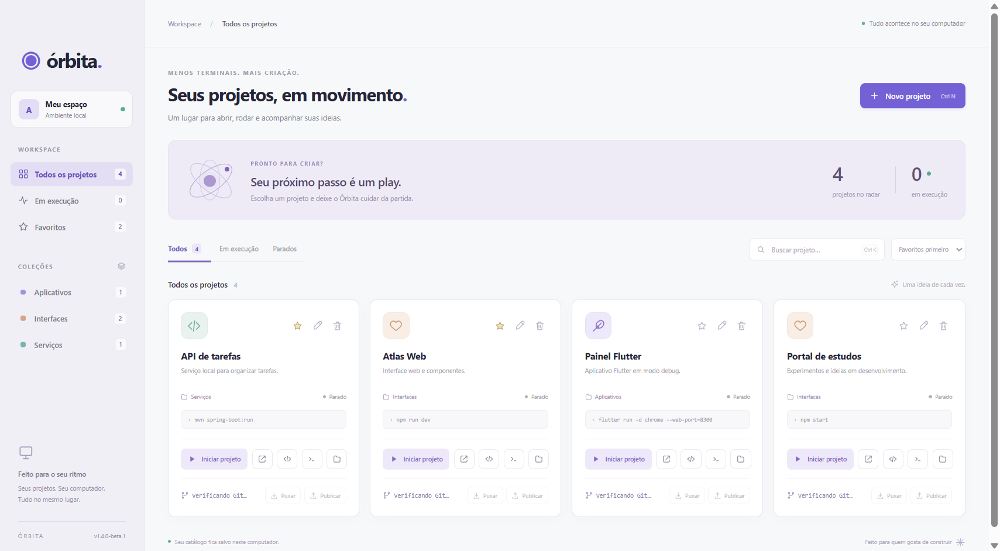
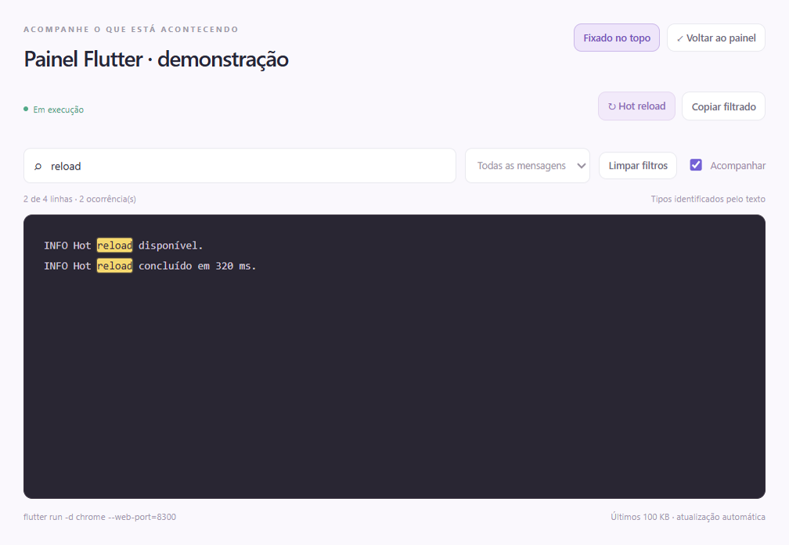

# Órbita · beta

Seu centro de comando para projetos locais. Organize suas pastas, execute seus comandos e acompanhe os logs em uma interface desktop em português.

[Baixar a beta](https://github.com/Antoniobins/orbita-launcher/releases) · [Reportar problema](https://github.com/Antoniobins/orbita-launcher/issues) · [Validação automática](https://github.com/Antoniobins/orbita-launcher/actions)



## Instalar e abrir

A primeira beta pública oferece um **ZIP portátil para Windows x64**. Baixe o ZIP nas Releases, extraia a pasta inteira e abra **Orbita.exe**. Preserve os outros arquivos ao lado do executável. Não precisa instalar Node.js para abrir o pacote; seus projetos continuam precisando das ferramentas que usam.

Os pacotes desta beta não têm assinatura digital. O Windows pode exibir avisos ao abrir. Confira a origem do download e o SHA-256 disponibilizado junto ao ZIP. No PowerShell:

```powershell
Get-FileHash .\Orbita-1.4.0-beta.1-win32-x64.zip -Algorithm SHA256
```

**macOS:** uso experimental pelo código-fonte; há validação automática e empacotamento no workflow. Esta beta não promete instalador assinado ou notarizado para Mac. **Linux:** ainda não suportado.

A beta foi testada por automação no ambiente de desenvolvimento; não representa validação em toda combinação de sistema e ferramentas. Consulte as execuções do workflow para os resultados de cada plataforma.

## Começar

1. Clique em **Novo projeto** e escolha a pasta.
2. Informe o comando que você usa no terminal e, opcionalmente, a URL local.
3. Salve e clique em **Iniciar**. Acompanhe a compilação nos logs.

O Órbita não instala dependências dos projetos. Git é necessário para os botões de branch, pull e publicação; Flutter, Java, npm e outras ferramentas precisam estar disponíveis no PATH quando usadas pelo comando.

## O que faz

- Cadastro de nome, pasta, comando, URL e coleção.
- Botões para iniciar, parar, abrir no navegador, abrir no VS Code e revelar a pasta.
- Logs em tempo real, favoritos, busca e filtros.
- Hot reload para Flutter em debug e filtros de logs por texto e tipo.
- Logs em janelas independentes, com opção de fixar no topo e marca-texto para a busca.
- Branch atual e botões para puxar atualizações e publicar commits.
- Verificação de porta local ocupada antes da execução.
- Encerramento dos processos iniciados pelo app ao sair.
- Catálogo persistido apenas no computador, sem conta ou servidor.

## Rodar pelo código-fonte

Requisitos: Node.js 22.12 ou superior, Git e uma sessão gráfica no Windows ou macOS.

```sh
git clone https://github.com/Antoniobins/orbita-launcher.git
cd orbita-launcher
npm ci
npm start
```

Para gerar um pacote no sistema atual:

```sh
npm run package
npm run archive
```

Os arquivos ficam em `dist/v1.4.0-beta.1/`. No Windows, extraia o ZIP e abra `Orbita.exe`; no macOS, o pacote contém `Orbita.app`. O build inclui apenas código, assets e documentação permitidos, sem catálogo pessoal ou histórico Git. Não há atualização automática: feche a versão anterior antes de abrir outra. O catálogo local é reaproveitado.

## Cadastrar projetos

Clique em **Novo projeto**, escolha a pasta e informe o comando que você usaria no terminal. O comando roda dentro da pasta escolhida: `cmd.exe` no Windows e shell de login `zsh` no macOS. O Órbita não instala dependências dos projetos automaticamente.

Exemplos:

| Projeto | Comando | URL |
| --- | --- | --- |
| Node / Vite | `npm run dev -- --port 5173` | `http://localhost:5173` |
| Flutter web | `flutter run -d chrome --web-port=8300` | `http://localhost:8300` |
| Spring Boot | `mvn spring-boot:run` | `http://localhost:8080` |

Use uma porta diferente para cada serviço que deseja executar simultaneamente. O status **Em execução** indica que o processo está ativo; a aplicação pode ainda estar compilando. Consulte os logs para verificar quando está pronta.

O botão do editor usa o protocolo `vscode://`, registrado pela instalação do VS Code. `Ctrl+N` / `⌘ N` abre o cadastro e `Ctrl+K` / `⌘ K` foca a busca.

## Hot reload e filtros de logs

Projetos com `pubspec.yaml` e comando `flutter run` em debug mostram **Hot reload** no cartão e na janela de logs. O botão envia `r` ao processo em execução, preservando o processo e o estado da aplicação. Ele é habilitado quando o Flutter anuncia o hot reload; em Chrome, Edge e web-server, também aguarda a mensagem de início da aplicação no navegador. O resultado aparece nos logs, incluindo eventuais erros de compilação. Modos release, profile e machine não habilitam esse controle.

A janela de logs combina busca literal sem diferenciar maiúsculas e filtros de **Erros**, **Avisos** ou **Informações**. Cada ocorrência da busca recebe um marca-texto amarelo, preservando o texto original. Os tipos são inferidos pelo texto das mensagens; stack traces acompanham o erro anterior. O contador mostra as linhas visíveis e ocorrências, **Copiar filtrado** copia apenas o texto dessas linhas e **Limpar filtros** restaura a visualização completa. Desmarque **Acompanhar** para pausar a rolagem automática enquanto analisa uma mensagem.

Use **Destacar janela** para mover os logs para uma janela independente, redimensioná-la ou arrastá-la para outro monitor. A janela mantém os filtros e continua recebendo logs em tempo real. **Sempre no topo** permite acompanhar os logs sobre o editor. **Voltar ao painel** reabre a modal com a busca e os filtros preservados. Cada projeto pode ter sua própria janela de logs; fechar uma delas mantém o projeto em execução.

## Puxar e publicar na branch

Cada cartão mostra a branch atual e a quantidade de arquivos alterados. As informações são atualizadas ao abrir o aplicativo, cadastrar um projeto ou voltar para a janela.

**Puxar** busca as alterações da branch remota e atualiza somente por fast-forward. Se houver alterações locais, conflitos ou históricos divergentes, o Órbita explica o impedimento para você resolver no editor.

**Publicar** abre uma revisão com o destino remoto, os arquivos alterados e a mensagem do commit. Escolha os arquivos que deseja incluir e clique em **Criar commit e publicar**. Arquivos não selecionados, inclusive alterações já preparadas no Git, ficam preservados localmente. Para enviar commits já existentes, deixe os arquivos desmarcados e use **Publicar commits**.

O destino segue o upstream da branch. Quando ainda não existe upstream, o app usa uma branch com o mesmo nome no remoto `origin` (ou no único remoto disponível) e configura o acompanhamento após o envio. A publicação não usa force push. Se o commit for criado e o envio falhar, ele permanece salvo no computador; reabra a revisão para tentar enviar novamente.

O Git utiliza as credenciais já configuradas no computador. Projetos sem repositório, sem remoto ou em detached HEAD mostram os botões indisponíveis. A integração não publica projetos automaticamente.

## Descoberta local opcional

O utilitário de descoberta encontra projetos Flutter e Maven dentro das pastas indicadas, sem alterar os arquivos de origem:

```sh
node scripts/discover.cjs data/projects.json 'Pessoais=/caminho/para/projetos'
npm start -- --import-local data/projects.json
```

A descoberta ignora dependências, builds e worktrees de agentes. Revise os comandos sugeridos para backends, que podem depender de banco de dados e configuração própria. Importações repetidas preservam cadastros que já usam a mesma pasta.

Os cadastros ficam no diretório `userData` do Electron, em `%APPDATA%\Órbita\projects.json` no Windows e `~/Library/Application Support/Órbita/projects.json` no macOS. Para backup, copie esse arquivo com o app fechado. A pasta `data/`, os logs e os cadastros pessoais não são versionados. O repositório contém apenas a ferramenta: não contém código nem cadastros dos projetos gerenciados.

## Validação

```sh
npm test
npm run smoke
```

Os testes verificam persistência, importação, execução, hot reload, filtros e marca-texto dos logs, conflitos de porta, Git, falhas e encerramento da árvore de processos. O smoke test verifica na interface cadastro, favorito, execução, hot reload, filtros, parada, busca, publicação Git, pull e remoção de projetos temporários. Também verifica destacar, redimensionar, fixar e recolher a janela dos logs, além das atualizações em tempo real e preservação dos filtros. Salva capturas locais em `screenshots/`.


## Limitações da beta

- Pacotes sem assinatura digital e sem notarização; sem atualização automática.
- macOS experimental; Linux sem suporte.
- O status **Em execução** indica processo ativo; consulte os logs para saber se o serviço está pronto.
- Comandos são executados com as permissões do usuário. Importe somente catálogos confiáveis e não execute como administrador.
- Processos que se desacoplam, como `docker compose up -d`, devem ser gerenciados pela ferramenta correspondente.
- Hot reload depende da saída e do modo debug do Flutter; as ferramentas dos projetos podem exigir configuração própria.
- Se uma pasta redirecionada impedir rename, o catálogo anterior é preservado em `projects.json.bak` antes da cópia. Essa alternativa não tem a atomicidade de rename; faça backups com o aplicativo fechado.



## Contribuir e licença

Veja [CONTRIBUTING.md](CONTRIBUTING.md), [SECURITY.md](SECURITY.md) e [CHANGELOG.md](CHANGELOG.md). Código sob [licença MIT](LICENSE).
